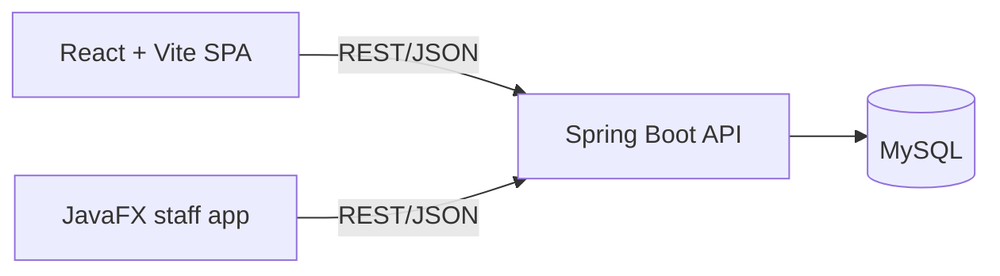

# EscapeCenter

Booking and management system for an escape-room venue: Spring Boot API, React booking site, JavaFX staff app.

<!-- TODO: demo GIF (React booking flow + JavaFX admin calendar), recorded with ScreenToGif -->

## Architecture



## Features

- Customers pick a room and a time slot on a weekly calendar and book it (Hebrew, RTL interface).
- Staff manage bookings and clients from a desktop app.
- REST API over MySQL, with HTTP Basic login for staff endpoints.
- Each room has its own first game time, number of games per day and break length (columns on the `rooms` table), so rooms can run different hours.

## Tech stack

| Part | Technology |
|------|-----------|
| API | Java 21, Spring Boot 3.4, JDBC |
| Database | MySQL 8.4 (Docker Compose) |
| Booking site | React 19, Vite |
| Staff app | JavaFX 21 |
| Security | Spring Security (HTTP Basic) |

## Quick start

Needs Docker, Java 21, Maven and Node.js.

```bash
cp .env.example .env          # then fill in the passwords
docker compose up -d          # MySQL; the API creates the schema (Flyway) when it starts
```

Export `MYSQL_USER`, `MYSQL_PASSWORD`, `APP_ADMIN_USER` and `APP_ADMIN_PASSWORD` in your shell (values are explained in `.env.example`), then:

```bash
cd Server_Side/EscapeCenter_Server && mvn spring-boot:run    # API on :8080
cd Client_Side/EscapeCenter_Web && npm install && npm run dev # site on http://localhost:5173
cd Server_Side/EscapeCenter_DemoApp && mvn javafx:run         # staff app (optional)
```

`mvn verify` starts its own throwaway MySQL with Testcontainers, so it only needs Docker running (no database or environment variables).

One-command start (`docker compose up` for the whole stack) arrives with the CI/CD phase.

## API

| Method | Path | Access | Purpose |
|--------|------|--------|---------|
| GET | `/api/rooms` | public | List rooms |
| GET | `/api/rooms/{id}/availability?date=YYYY-MM-DD` | public | Slots of a room on a day, free or taken |
| POST | `/api/bookings` | public | Create a booking (400 invalid, 409 slot taken) |
| GET | `/api/bookings?from&to&roomId` | staff | List bookings in a date range |
| PUT | `/api/bookings/{id}` | staff | Update client and booking details |
| DELETE | `/api/bookings/{id}` | staff | Delete a booking |
| GET | `/api/clients?query=` | staff | Search clients by name or phone |
| GET | `/api/staff/check` | staff | Check the staff login |

Errors come back as [RFC 7807](https://www.rfc-editor.org/rfc/rfc7807) `ProblemDetail` JSON.

Swagger UI is planned (see roadmap).

## Roadmap

Next: input validation, a cleaner data layer and tests, then CI/CD, an event-driven email service and a live demo.
