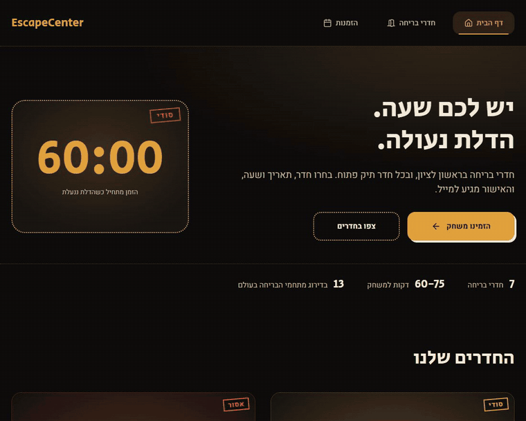
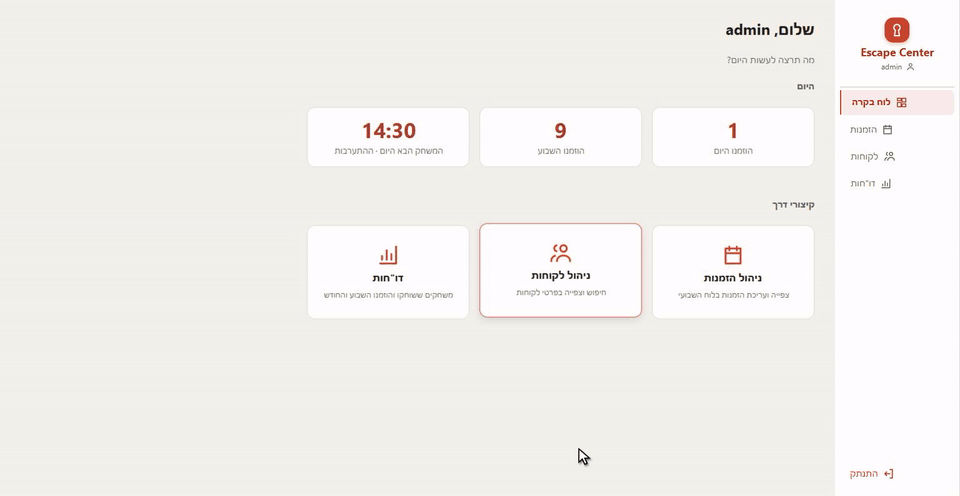
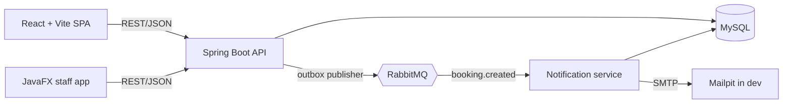

# EscapeCenter

[](https://github.com/TonnyGol/EscapeCenter-Demo/actions/workflows/ci.yml)

Booking and management system for an escape-room venue: Spring Boot API, React booking site, JavaFX staff app.

Website, Lighthouse on the production build (2026-11-16): performance 95, accessibility 100, best practices 96, SEO 100.





## Architecture



### Booking emails

Creating a booking never waits for an email:

1. The API saves the booking **and** a `BookingCreated` row in `outbox_events` in one database transaction.
2. A scheduled job in the API sends unpublished rows to the RabbitMQ exchange `bookings` and marks them published.
3. The notification service reads the queue `bookings.notifications` and sends the email (Mailpit in dev, any SMTP server through `MAIL_HOST` / `MAIL_PORT` in production).

**Why an outbox?** Saving the booking and sending a message are two systems, and no single transaction covers both. Without the outbox, a crash between them gives a booking with no email, or an email for a booking that was rolled back. With it, the event exists if and only if the booking does.

**What happens when something is down**

| Down | Result |
|------|--------|
| RabbitMQ | Bookings still work. Events stay unpublished in `outbox_events` and go out when the broker is back. |
| Notification service | Messages wait in the durable queue and are delivered when it restarts. |
| Email server | The message is retried 3 times (1 s, then 2 s apart), then moved to the dead-letter queue `bookings.dlq` with the error in its headers. Look at it in the RabbitMQ UI (http://localhost:15672) and move it back to the exchange to try again. |

Delivery is at-least-once, so the same event can arrive twice. The notification service writes each event's id to `processed_events` in the same transaction as the email and skips ids it has seen. Published outbox rows are deleted after 7 days.

**Known limit:** the email address in a public booking is not verified, so someone could enter a stranger's address and that person would get the confirmation. The rate limit slows this down but does not stop it. A confirmation link in the email (roadmap phase 7b, customer self-service) is the real fix; add it before real customers use the site.

In dev, every email lands in Mailpit at http://localhost:8025 and nothing leaves your machine.

## Design decisions

- **The database prevents double booking, not the code.** The service checks for a taken slot first so the customer gets a clear 409, but two requests can pass that check at the same moment. A unique constraint on `(room_id, start_at)` is the real guard: the second insert fails and the API turns that one constraint into the same 409. No application lock is needed, and it works with any number of server instances.
- **Booking and email are made reliable by the outbox, not by hoping.** See [Booking emails](#booking-emails): the event is saved in the same transaction as the booking, so a crash can never leave one without the other.
- **Email is a separate service behind RabbitMQ.** A broker or mail outage never blocks a booking, and the notification service can be restarted or scaled without touching the API.

## Features

- Customers pick a room and a time slot on a weekly calendar and book it (Hebrew, RTL interface).
- Staff manage bookings and clients from a desktop app.
- REST API over MySQL, with HTTP Basic login for staff endpoints.
- Each room has its own first game time, number of games per day and break length (columns on the `rooms` table), so rooms can run different hours.

## Tech stack

| Part | Technology |
|------|-----------|
| API | Java 21, Spring Boot 3.4, JDBC |
| Database | MySQL 8.4 (Docker Compose) |
| Messaging | RabbitMQ, transactional outbox, notification service (Spring Boot) |
| Booking site | React 19, Vite |
| Staff app | JavaFX 21 |
| Security | Spring Security (HTTP Basic) |

## Develop it

Just want to run it? See [Try it on your computer](#try-it-on-your-computer-live-demo). To work on the code you need Docker, Java 21, Maven and Node.js.

```bash
cp .env.example .env                              # then fill in the passwords
docker compose up -d mysql rabbitmq mailpit       # only the services; you run the API and the site from source below
```

Export `MYSQL_USER`, `MYSQL_PASSWORD`, `APP_ADMIN_USER` and `APP_ADMIN_PASSWORD` in your shell (values are explained in `.env.example`), then the API creates the schema (Flyway) when it starts:

```bash
cd Server_Side/EscapeCenter_Server && mvn spring-boot:run    # API on :8080
cd Client_Side/EscapeCenter_Web && npm install && npm run dev # site on http://localhost:5173
cd Server_Side/EscapeCenter_DemoApp && mvn javafx:run         # staff app (optional)
```

`mvn verify` starts its own throwaway MySQL with Testcontainers, so it only needs Docker running (no database or environment variables).

## Try it on your computer (live demo)

You run the whole system on your own computer: the server and website in Docker, and the staff app as a Windows program. Nothing is installed besides Docker, and nothing leaves your machine (emails go to a fake inbox). It takes about 10 minutes, most of it the first download.

### What you need
- **Windows 10 or 11.**
- **Docker Desktop**, installed and running (free: https://www.docker.com/products/docker-desktop).

### 1. Download
- **The project:** on this page click **Code → Download ZIP**, then unzip it. (Or `git clone https://github.com/TonnyGol/EscapeCenter-Demo.git`.)
- **The staff app:** open the [Releases](https://github.com/TonnyGol/EscapeCenter-Demo/releases) page, download `EscapeCenter-Staff-Windows.zip` and unzip it anywhere.

### 2. Start the server and website
Open PowerShell in the project folder (in File Explorer: open the folder, click the address bar, type `powershell`, press Enter) and run:

```powershell
powershell -ExecutionPolicy Bypass -File .\start-demo.ps1
```

The first run builds everything and takes a few minutes. When it prints the addresses, the system is ready. (`-ExecutionPolicy Bypass` only lets Windows run this one script; it changes no setting.)

### 3. Look around
1. **Book a room as a customer:** open http://localhost, choose a room and book a time. Pick today if you want to see it appear on the staff dashboard.
2. **Read the confirmation email:** open http://localhost:8025. This is a fake inbox that catches every email the system sends, so you can see the booking confirmation without a real mail server.
3. **Open the staff app:** run `EscapeCenter.exe` from the unzipped folder and log in with the staff login the start script printed at the end (user `admin`, and a random password that is also in the `.env` file). Windows may show a blue "unknown publisher" warning because the app is not signed: click **More info → Run anyway**. Look at the dashboard, bookings, clients and reports, and find the booking you just made.
4. **Work like the staff would:** change your booking, mark a game as arrived or no-show, add a booking for a phone customer, and watch the dashboard update. Refresh the website to see the time slot is taken.
5. **Try it on a phone:** with the phone on the same Wi-Fi as the computer, open the `Phone:` address the start script printed (like `http://192.168.1.20`). Only the website is shared on the network; the API, the database and the fake inbox stay on this computer. Type it with `http://` (not `https://`). If the page does not open, Windows Firewall is probably blocking it: it often allows Docker only on "public" networks, while a home Wi-Fi is "private". Allow port 80 on private networks once, in PowerShell opened as administrator:

```powershell
New-NetFirewallRule -DisplayName "EscapeCenter demo website (port 80)" -Direction Inbound -Protocol TCP -LocalPort 80 -Action Allow -Profile Private
```

To undo it later: `Remove-NetFirewallRule -DisplayName "EscapeCenter demo website (port 80)"`. If it still does not open, check that the Wi-Fi is not a guest network with "client isolation".

### Stop it
```powershell
docker compose down
```
Run it from the project folder. Start again later with the same command as in step 2, which is much faster the second time. If the staff app says the username or password is wrong, first check that Docker Desktop is running and the system is started.

### Good to know
- The first start creates a `.env` file next to the script, with random passwords for the database, the message broker and the `admin` staff login. It stays on your computer and is never uploaded. The demo is meant for your own machine and your home network: do not expose its ports to the internet (no port forwarding on your router).
- Want to build the staff app yourself? With JDK 21 or newer, run `.\build-exe.ps1` in `Server_Side/EscapeCenter_DemoApp`. It makes `dist/EscapeCenter-Staff-Windows.zip`.
- A public version on a server with HTTPS is planned for when this becomes a real product. The files are ready (`docker-compose.prod.yml` and `Caddyfile`).

## API

| Method | Path | Access | Purpose |
|--------|------|--------|---------|
| GET | `/api/rooms` | public | List rooms |
| GET | `/api/rooms/{id}/availability?date=YYYY-MM-DD` | public | Slots of a room on a day, free or taken |
| POST | `/api/bookings` | public | Create a booking (400 invalid, 409 slot taken) |
| GET | `/api/bookings?from&to&roomId` | staff | List bookings in a date range |
| PUT | `/api/bookings/{id}` | staff | Update client and booking details |
| DELETE | `/api/bookings/{id}` | staff | Delete a booking |
| GET | `/api/clients?query=` | staff | Search clients by name or phone |
| GET | `/api/staff/check` | staff | Check the staff login |

Errors come back as [RFC 7807](https://www.rfc-editor.org/rfc/rfc7807) `ProblemDetail` JSON.
